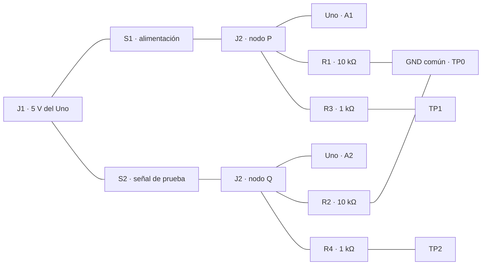

# Banco de arnés del módulo auxiliar

**Maqueta didáctica de 5 V por USB.** Etiqueta el banco y mantenlo separado de cualquier sistema real del autobús. Los valores de esta práctica son didácticos.

## Materiales

- Arduino Uno R3 dedicado al banco y cable USB de datos.
- Dos interruptores simples (S1 y S2) y dos resistencias de 10 kΩ (R1 y R2).
- Dos resistencias de 1 kΩ (R3 y R4), tres bornes de prueba, cables y una base de montaje.
- Multímetro con puntas negra y roja.

## Diagrama y cableado



Con el USB desconectado, conecta el pin 5V a un terminal de cada interruptor. En el otro terminal de S1 une P con A1, R1 hacia GND y R3 hacia TP1. En el otro terminal de S2 une Q con A2, R2 hacia GND y R4 hacia TP2. Une la tierra de J1 y J2 con GND y TP0. Coloca TP1 y TP2 del lado de J2, después de los interruptores y sus resistencias en serie. Carga el sketch siguiendo la [guía del firmware](../firmware/banco/README.md).

## Prueba de aceptación

Conecta el USB. Selecciona voltaje continuo en el multímetro y deja la punta negra en TP0. En cada fila, toca TP1 y TP2 con la punta roja y comprueba las lecturas. En el monitor serial a 115200 baudios verifica los valores de los nodos.

| Estado | S1 | S2 | TP1 | TP2 | `nodo_p` | `nodo_q` |
| --- | --- | --- | ---: | ---: | ---: | ---: |
| Sano | Cerrado | Cerrado | ≈5 V | ≈5 V | 1 | 1 |
| Falla de alimentación | Abierto | Cerrado | ≈0 V | ≈5 V | 0 | 1 |
| Falla de señal | Cerrado | Abierto | ≈5 V | ≈0 V | 1 | 0 |

## Conexión y práctica en el simulador

1. En Linux, cierra el monitor serial y ejecuta el puente desde la raíz. Sustituye el puerto por el del banco. El puente usa Python 3 y reenvía cada línea por UDP local a `127.0.0.1:11521`.

   ```sh
   python3 tools/puente_banco.py /dev/ttyACM0
   ```

2. Inicia el simulador desde la raíz con `godot --path godot -- --banco-fisico` y abre la orden del módulo auxiliar. El instructor deja abierto S1 o S2 según la falla que quiere presentar. Comprueba que el rótulo indique **Fuente: banco físico**.
3. Mide TP1 y TP2 con el multímetro real. Abre **Multímetro · Registro y diagnóstico** y elige **≈0 V**, **≈5 V** u **Otra** para cada punto. El simulador guarda cada opción como `lectura-reportada`. Confirma el diagnóstico y selecciona **Reconectar conductor**.
4. Cierra el interruptor abierto. El banco comunica el restablecimiento y el simulador confirma la reparación. En el reintento el instructor prepara la otra falla. Repite las mediciones, el registro, el diagnóstico y el cierre.
5. Para comprobar el respaldo, inicia una práctica y desconecta el USB. A los tres segundos sin latido debe aparecer **Banco desconectado · falla virtual**. Continúa en la misma práctica. Para recuperar el enlace tras reconectar el USB, vuelve a ejecutar el puente.

## Plan B con el multímetro virtual

Comprueba que el rótulo indique **Fuente: virtual**. Toca primero TP0 y después TP1. Repite desde TP0 para medir TP2. Reporta ambas lecturas en el menú, confirma el diagnóstico y selecciona **Reconectar conductor**. Completa la reparación con **Confirmar** en el panel virtual. Pulsa **Reintentar** para recorrer la otra variante.

Para verificar el protocolo sin el Uno, el emisor de prueba genera un latido, los estados iniciales y el cierre de S1.

```sh
godot --headless --no-header -s tools/emisor_eventos.gd -- --banco
```

## Banco con ESP32 (Wi-Fi, 3.3 V)

La placa crea su red Wi-Fi, espera `INICIO` en UDP 4210 y reporta `{"tp1":0,"tp2":1}` cada 250 ms. Conecta la laptop a esa red y ejecuta el adaptador, que traduce los bits al protocolo del simulador y envía un latido mientras la placa responde:

```sh
python3 tools/puente_esp32.py 192.168.4.1
godot --path godot -- --banco-fisico --nominal-alto=3.3
```

Con `--nominal-alto=3.3` las opciones de la hoja y los textos dicen **≈3.3 V** en lugar de ≈5 V. Los GPIO del ESP32 solo aceptan 3.3 V: no apliques 5 V directos. Si la placa deja de responder, el latido se corta y el simulador avisa **Banco desconectado · falla virtual**.

Prueba de lógica del adaptador: `python3 firmware/pruebas/prueba_puente_esp32.py`.
